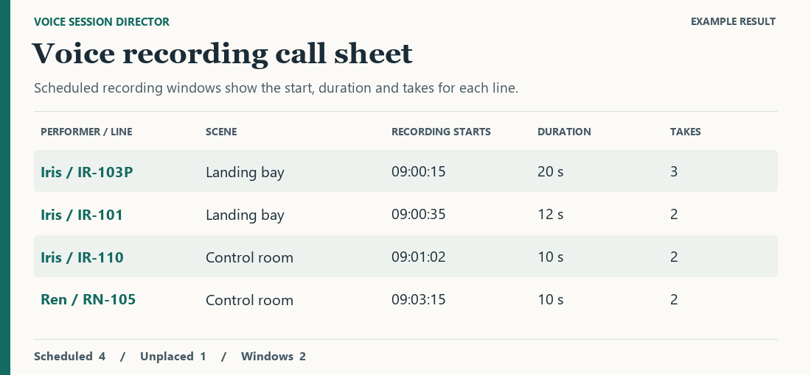
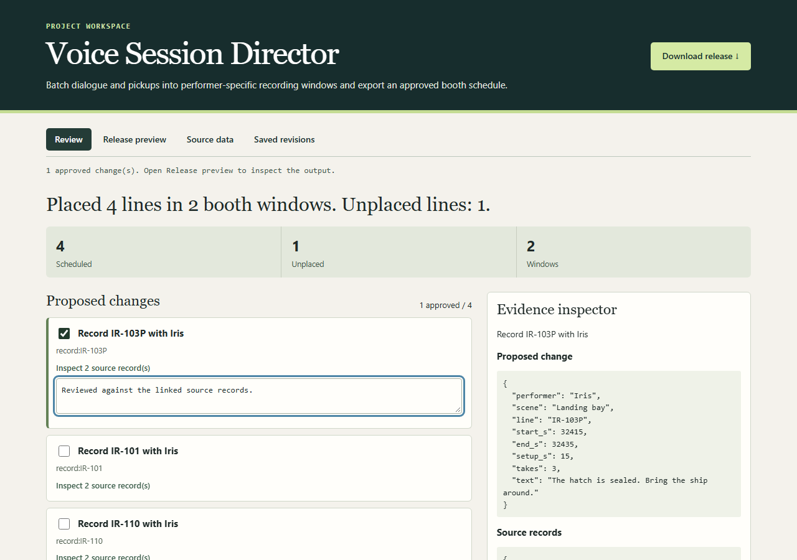

# Voice Session Director

Batch dialogue and pickups into performer-specific recording windows and export an approved booth schedule.

**[Open the live demo](https://oguzhanozfe.github.io/voice-session-director/)** · [](https://github.com/oguzhanozfe/voice-session-director/actions/workflows/check.yml) · [Deploy to Render](https://render.com/deploy?repo=https://github.com/oguzhanozfe/voice-session-director) · [Input guide](GUIDE.md)

A pickup line needs its original performer back in the booth. Fit it into the available recording windows and hand the confirmed schedule to the director.



The live demo lets you edit the input, search proposed changes with an on-device model and download the result. [Browser demo details](demo/DEMO.md)

## Try it

With Python 3.11+ installed, clone this repository and run:

```sh
git clone https://github.com/oguzhanozfe/voice-session-director.git
cd voice-session-director
python app.py
```

Open <http://127.0.0.1:8000>. The synthetic example is loaded. Select a proposed change, inspect its source records, and open **Release preview** to see the resulting files. Choose **Download release** to save them.

## Walk through the example

A booth supervisor has fixed windows for two performers and one actor who is unavailable. Upload the script log and the session windows to find a workable order and an explicit list of lines that did not fit.

**What the engine finds.** Placed 4 lines in 2 booth windows. Unplaced lines: 1.

**Try this decision.** Approve **Record IR-103P with Iris**. The [example review](docs/example-review.json) lists the supporting record IDs and the checksum of each exported file. Its native outputs are [`booth-schedule.csv`](docs/example-release/booth-schedule.csv).

Reproduce that release at the command line:

```sh
python app.py analyze example.json
python app.py export example.json --approve "record:IR-103P" --out reviewed.zip
```

## Model-assisted review

With a local model in Ollama or LM Studio, Azure OpenAI, Amazon Bedrock, or a compatible API connected, select **Request suggestions**. The model examines up to eight candidate actions. Each displayed suggestion links to one of that action's source records. Approving a change and recording a review note remain explicit reviewer actions.

The app runs locally with Python's standard library. The Docker image includes the Bedrock SDK and the production web server. The same UI can save immutable revisions, reopen a workspace and compare decisions. See [model settings, Docker deployment and the HTTP API](docs/deployment.md).



## Development

The domain algorithm and exporter live in [pipeline.py](pipeline.py). The [method guide](GUIDE.md) describes its input assumptions and limitations. Install test dependencies and run the suite:

```sh
python -m pip install -r requirements.txt
python -m unittest discover -v
```

[MIT license](LICENSE)
